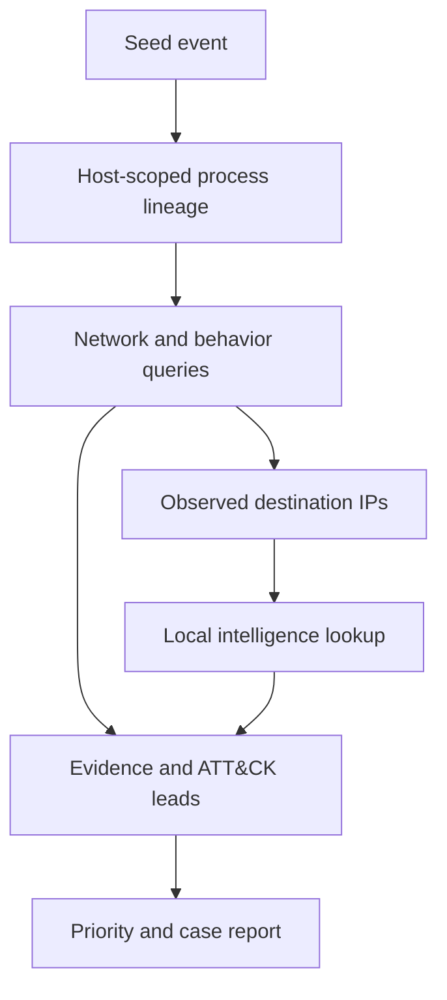

# SentinelForge

An evidence-led investigation agent for Windows telemetry. Start from a host and
record ID; the agent queries a read-only MCP server for process lineage, network
connections, behavior-specific detections, and threat-intelligence matches. It
returns a prioritized case with evidence references and the exact tool-call trace.

The included planner is deterministic and adaptive: process GUIDs found in the
lineage determine subsequent network and behavior queries; observed destination
IPs determine intelligence lookups. It does not need an LLM or API key. Any MCP
host can also use the tools directly.

## Run an investigation

Requires Python 3.11 or newer:

```bash
python -m venv .venv
source .venv/bin/activate
# Windows PowerShell: .venv\Scripts\Activate.ps1
python -m pip install -e '.[dev]'
sentinel-forge --events data/events.jsonl --intel data/intel.json \
  --host LAB-WS01 --record-id 2 --output reports/investigation.md
pytest -q
```

The demo starts a real MCP server subprocess and talks to it over stdio. The
synthetic PowerShell seed produces eight correlated events, five detection leads,
a P1 priority, and twelve tool calls. The unrelated Notepad process and its
connection stay outside the case. Inspect the [Markdown case](examples/investigation.md)
or [full JSON evidence](examples/investigation.json).

```bash
sentinel-forge --events data/events.jsonl --intel data/intel.json \
  --host LAB-WS01 --record-id 2 --format json --output reports/case.json
```

## MCP tools

| Tool | Purpose |
|---|---|
| `get_event` | Seed lookup scoped to host and record ID |
| `query_events` | Bounded event-ID and process-GUID queries |
| `process_tree` | Ancestors and descendants from Sysmon process creation |
| `network_activity` | Sysmon Event ID 3 for a specific process GUID |
| `powershell_activity` | Encoded-command and network-retrieval leads |
| `lsass_access` | Sysmon 10 LSASS access with PROCESS_VM_READ |
| `psexec_activity` | PsExec binary/service process leads |
| `scheduled_tasks` | schtasks creation and Security 4698 leads |
| `threat_intelligence` | Exact IP match against a local JSON feed |

Run the server independently:

```bash
sentinel-forge-server --events data/events.jsonl --intel data/intel.json
```

A typical MCP host configuration follows this shape; replace all paths with
absolute paths on your machine:

```json
{
  "mcpServers": {
    "sentinel-forge": {
      "command": "/absolute/path/to/.venv/bin/python",
      "args": ["-m", "sentinel_forge.server", "--events", "/absolute/path/to/data/events.jsonl", "--intel", "/absolute/path/to/data/intel.json"]
    }
  }
}
```

On Windows, point `command` at `.venv\\Scripts\\python.exe`. The server is pinned
to MCP SDK 1.30.0, using its `FastMCP` interface. It is a stdio server; it has no
HTTP listener or remote authentication configuration.

## Investigation flow



Each query is bounded. The planner has a default budget of 32 tool calls and
marks a case incomplete when the budget is exhausted or results are truncated.
Missing process GUIDs also produce an explicit limitation. `--max-calls` changes
the budget. Exit code 2 marks incomplete cases; their reports are still written.
Tool errors fail the investigation instead of silently producing a complete case.

## Priority model

The score is the highest detector severity, plus 10 for a suspicious match in the
local intelligence snapshot, capped at 100. Scores ≥85 map to P1, ≥60 to P2, and
the rest to P3. The score is an investigation heuristic, not a probability of
compromise. No match in the intelligence feed does not mean an indicator is safe.
The supplied feed contains a clearly labeled synthetic indicator.

## Work with your logs

Use [the event format and export instructions](docs/events.md). The server loads
a fixed snapshot at startup; restart it after replacing the input. Process
correlation uses host plus GUID rather than PID, which can be reused. The
[design notes](docs/design.md) describe correlation scope and limitations;
[detection coverage](docs/detections.md) lists the ATT&CK mappings.

For interoperability with JEV, use the same event file in both projects. Select an
escalated JEV record, then pass its host and record ID to SentinelForge. The
projects have independent CLIs and do not require each other to be installed.

## Validation and limits

Tests cover host isolation, GUID correlation, access-mask interpretation, cycle
handling, query bounds, intelligence validation, missing context, budget exhaustion,
MCP tool registration, and a complete client/server round trip. CI also checks
lint and formatting on Python 3.11–3.13.

This version investigates exported snapshots. It does not query a live endpoint,
execute response actions, or use a generative-model planner. Network evidence is
limited to configured Sysmon logging. PowerShell 4104 and Security 4698 records
without process GUID enrichment cannot be correlated into a process-led case.
Shared ancestors can include legitimate sibling processes, and all detections
need analyst validation. Production use would need indexed storage, time windows,
feed freshness policies, access control, and validation against real labeled cases.

## References

- [MCP Python SDK](https://github.com/modelcontextprotocol/python-sdk)
- [Microsoft Sysmon](https://learn.microsoft.com/en-us/sysinternals/downloads/sysmon)
- [MITRE ATT&CK](https://attack.mitre.org/)

MIT license.
